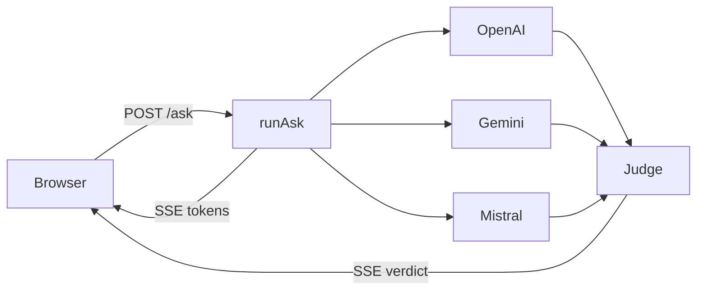

# SelfAssistant

One prompt goes to three models at once. Their answers stream live, then an evaluator writes a new answer from the strongest points — the same idea as self-consistency, across providers instead of repeated samples from one model.

Vite + React frontend, Node API, Zod for the judge response.

## Quick start

From the repo root:

```bash
npm install
```

Create `.env` (do not commit it):

```
OPENAI_API_KEY=...
GEMINI_API_KEY=...
MISTRAL_API_KEY=...

# Optional
MODEL_TEMPERATURE=0.7
PORT=3001
```

```bash
npm run dev
```

- UI: http://localhost:5173
- API: http://localhost:3001 (`/ask` is proxied by Vite in dev)

## What you get

Three model panels fill in as tokens arrive, then a synthesized-answer panel.

1. The UI posts the prompt to `POST /ask`.
2. OpenAI, Gemini, and Mistral run in parallel. Tokens stream to the browser over Server-Sent Events.
3. Finished answers are normalized and sent to the evaluator in random order.
4. The evaluator returns `winner` (who contributed the most useful material), `reasons` (notes per model), and `bestAnswer` (a new answer in its own words).
5. If synthesis is empty, the verdict falls back to the winning model's answer.

## Models

| Role | Provider | Model |
|------|----------|-------|
| Generator | OpenAI | `gpt-5.6` |
| Generator | Google Gemini | `gemini-3.1-flash-lite` |
| Generator | Mistral | `mistral-large-latest` |
| Evaluator | OpenAI | `gpt-5.6-terra` |

## Architecture



Local `server.js` and the Netlify function both call `runAsk`.

| File | Role |
|------|------|
| `src/App.jsx` | Prompt, loading state, panels |
| `src/lib/streamCompare.js` | SSE client |
| `src/api/runAsk.js` | Parallel calls, then the judge |
| `server.js` | Local HTTP API |
| `netlify/functions/ask.mjs` | Same `/ask` route on Netlify |

## Scripts

| Script | What it does |
|--------|----------------|
| `npm run dev` | API and Vite together |
| `npm run dev:api` | API only (port 3001) |
| `npm run dev:ui` | Vite only (port 5173) |
| `npm run build` | Production React build |
| `npm run preview` | Preview the production build |
| `npm run dev:netlify` | Local Netlify dev (UI + `/ask` function) |
| `npm run cli` | Terminal compare. The body of `index.js` is commented out |


